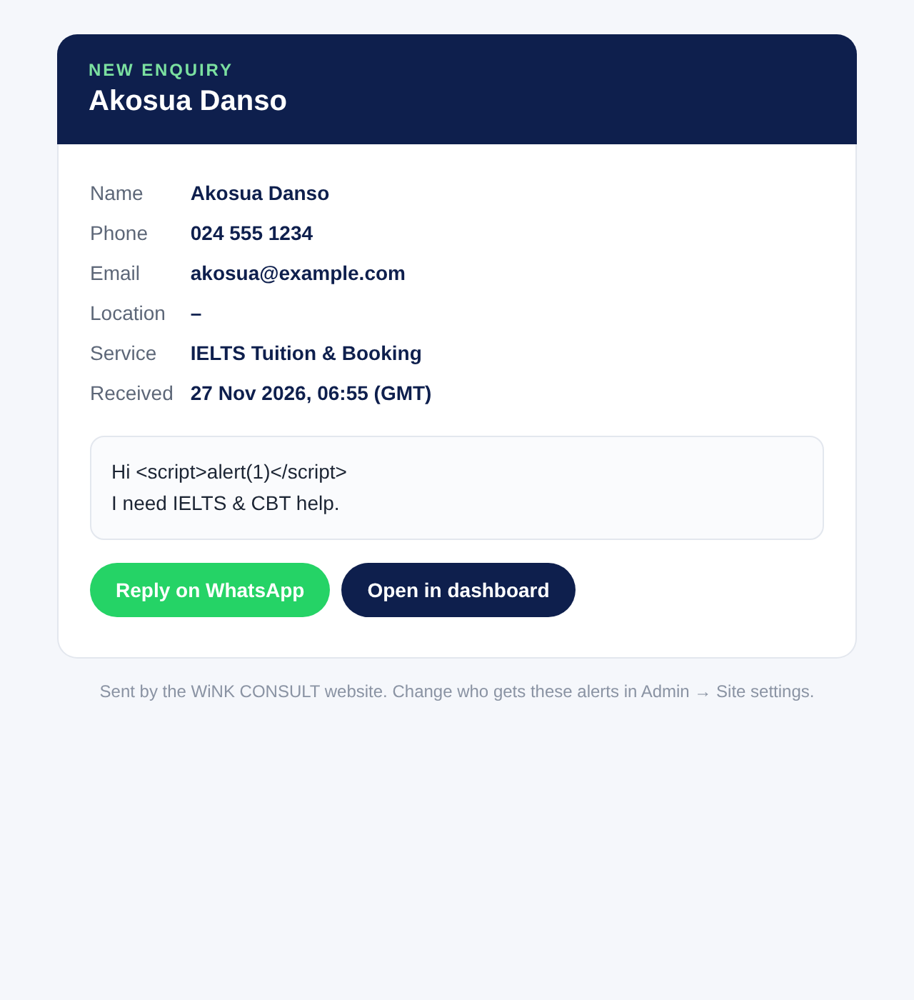

# WiNK CONSULT website and admin dashboard

The public website for WiNK CONSULT, plus a private dashboard where WiNK's staff manage enquiries, bookings, classes and website content.

- **Public site:** Home, About, Services, Classes & booking, Updates (blog), FAQ, Contact
- **Admin dashboard** (`/admin`):
  - **Enquiries:** inbox for the contact form, with status, internal notes, a WhatsApp reply button and CSV export
  - **Email alerts:** staff get an email for every new enquiry, with the message, a WhatsApp reply button and a link to the dashboard
  - **Bookings:** class seats and consultation requests; confirm, cancel or complete them, send a WhatsApp confirmation, export to CSV
  - **Classes:** create IELTS, CBT and other classes with dates, fee and seat limits; the site shows live seats left and stops taking bookings when a class is full
  - **Updates:** write and publish blog posts with a Markdown editor and preview, including scheduled publishing
  - **Services and FAQs:** edit the text on the Services and FAQ pages (admins only)
  - **Site settings:** WhatsApp and phone numbers, email, opening hours (these drive the consultation time slots), home page text, destinations, and a notice bar (admins only)
  - **Staff accounts:** add staff, set roles, reset passwords, deactivate accounts

## Stack

| Part | Choice | Cost |
| --- | --- | --- |
| App | Next.js 15 (App Router, server actions), TypeScript | — |
| Database | MongoDB Atlas (free M0 cluster, 512 MB) | Free |
| Hosting | Vercel Hobby (free tier) | Free |
| Email alerts | Resend (free tier: 3,000 emails/month) | Free |
| Domain | e.g. `winkconsult.com` | ~$10–15 / year |

There are no other paid services. Logins, sessions and spam protection are built into the app, so it needs nothing beyond MongoDB.



## Run it locally

You need Node 20 or newer and a MongoDB database (a free Atlas cluster works fine for development too).

```bash
npm install
cp .env.example .env.local      # then fill in MONGODB_URI and APP_SECRET
npm run db:setup                # create the indexes
npm run db:seed                 # load WiNK's services, FAQs and settings
ADMIN_EMAIL=you@example.com ADMIN_PASSWORD='a-long-password' ADMIN_NAME='Your Name' npm run admin:create
npm run dev                     # http://localhost:3000, admin at /admin
```

## Deploy to production (free tier)

### 1. Database: MongoDB Atlas

1. Create a free account at [mongodb.com/atlas](https://www.mongodb.com/cloud/atlas) and create a **free (M0)** cluster. Pick the region closest to Ghana, such as **AWS London (eu-west-2)**.
2. Under **Database Access**, add a database user with a long password and the **Read and write to any database** role.
3. Under **Network Access**, allow access from anywhere (`0.0.0.0/0`). Vercel doesn't use fixed IP addresses, so this is required; the database user's password still protects the data.
4. Choose **Connect → Drivers** and copy the connection string (`mongodb+srv://…`). Put your user's password into it. This is your `MONGODB_URI`. The app stores its data in a database called `wink` (change it with `MONGODB_DB`).
5. On your computer, put that string in `.env.local` and run:
   ```bash
   npm run db:setup
   npm run db:seed
   ADMIN_EMAIL=… ADMIN_PASSWORD=… ADMIN_NAME=… npm run admin:create
   ```

`db:setup` creates the indexes. These keep emails and web addresses unique, and they delete expired sessions and old sign-in attempts automatically. It's safe to run again at any time.

### 2. Hosting: Vercel

1. In [vercel.com](https://vercel.com), choose **Add New → Project** and import the `winkconsult` GitHub repository.
2. Add these environment variables:
   - `MONGODB_URI`: the Atlas connection string
   - `APP_SECRET`: a long random string; generate one with `node -e "console.log(require('crypto').randomBytes(32).toString('hex'))"`
   - `SITE_URL`: e.g. `https://www.winkconsult.com` (used for the dashboard link in alert emails)
   - `RESEND_API_KEY` and `EMAIL_FROM`: for email alerts (see below)
   - Set each variable for **Production** and **Preview**. The build reads the database to pre-render pages, so `MONGODB_URI` must be set, and step 1 completed, **before** the first deploy. Otherwise the build fails with "MONGODB_URI is not set" or a connection timeout (check Network Access in Atlas).
3. Deploy. The site runs in Vercel's London region (`lhr1`), close to both an Atlas cluster in London and visitors in Ghana. `vercel.json` also sets up a daily health check that pings the database.

### 3. Email alerts: Resend

1. Create a free account at [resend.com](https://resend.com) and create an API key. Add it to Vercel as `RESEND_API_KEY`.
2. Under **Domains**, add WiNK's domain and create the DNS records Resend lists. Then set `EMAIL_FROM` to an address on that domain, e.g. `WiNK Website <alerts@winkconsult.com>`.
   - Until a domain is verified, Resend only sends from `onboarding@resend.dev`, and only to the email address you signed up to Resend with. That's enough for a first test.
3. Redeploy. Then, in the dashboard, open **Site settings → Email alerts**, enter the addresses that should get alerts (one per line), save, and press **Send a test email**.

Each enquiry shows whether its alert was sent. If sending failed (for example during an outage), staff can press **Send alert** to try again. Email problems never stop a visitor's enquiry from being saved.

### 4. Domain

Buy the domain from any registrar. In Vercel, open **Project → Settings → Domains**, add it, and follow the DNS instructions.

## Guide for WiNK staff

- **Sign in** at `yourdomain.com/admin`.
- **New enquiries and bookings** show as green numbers in the sidebar. Open one, reply with the **WhatsApp** button, then set the status and add notes so the team knows what happened.
- **Bookings:**
  - Set a booking to **Confirmed** once payment or attendance is agreed.
  - **Cancelling** a class booking frees the seat on the website.
  - Use **Send confirmation on WhatsApp** to message the client a ready-written confirmation.
- **Classes:** add a class with its start date, fee and number of seats. Untick **Show on website** to hide it, or set **Registration** to **Closed** to stop new bookings.
- **Updates:** write a post and set it to **Published**. A future publish date schedules it. Changes appear on the site within about 5 minutes.
- **Settings** (admins only): changing the WhatsApp number updates every WhatsApp button on the site. Opening hours control which consultation times people can choose.

## Security notes

- Passwords are hashed with bcrypt (cost 12).
- Sessions are random tokens stored as SHA-256 hashes, in `httpOnly`, `SameSite=Lax` cookies that are `Secure` in production. They expire after 14 days.
- Sign-in locks for 15 minutes after 8 failed attempts from the same email or IP address.
- Every admin page and server action checks the session against the database, and admin-only actions also check the role. The middleware redirect is only a first gate.
- Server actions use Next.js's built-in origin check, which protects them against cross-site request forgery.
- The public forms check every field on the server, include a hidden honeypot field for bots, and accept at most 5 submissions per hour from one visitor. Visitor IP addresses are stored only as salted hashes.
- Markdown is rendered without raw HTML, so content can't inject scripts.
- CSV exports protect against formula injection in Excel and Google Sheets.
- Admin pages send `noindex` and `no-store` headers.

## Not included yet

- **Alerts for bookings, and SMS alerts.** Only new enquiries trigger an email. Bookings could use the same mechanism.
- **Image uploads for posts.** Posts currently link to a cover image by URL; a storage service such as Cloudinary or Vercel Blob could add uploads later.
- **Online payments.** Booking confirmations ask clients to pay by MoMo or bank transfer; Paystack could be added later.
